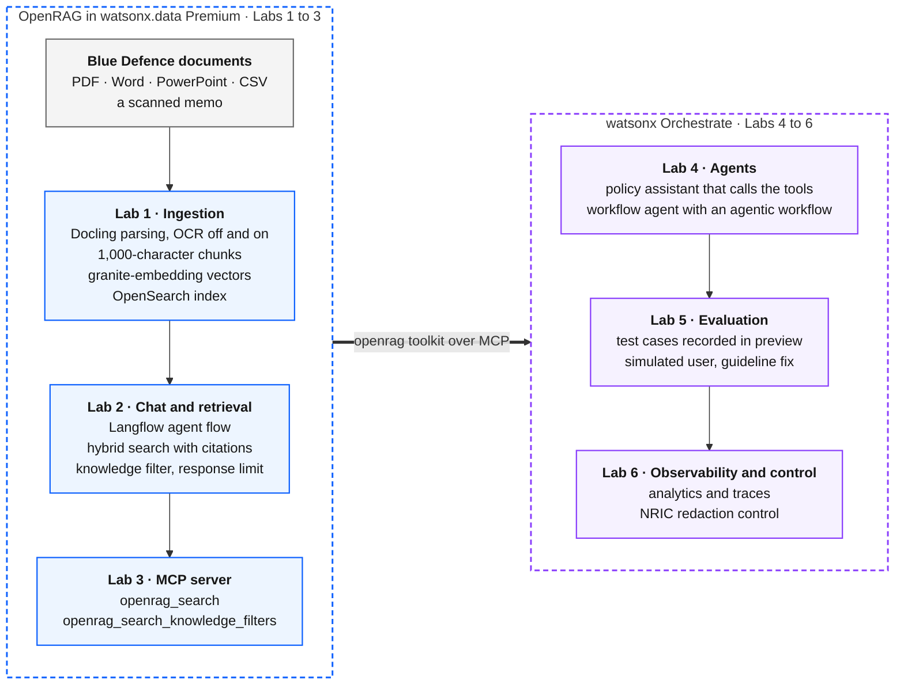

# watsonx Workshop

Hands-on labs for retrieval-augmented generation (RAG) with OpenRAG in watsonx.data Premium 2.4.x, and for
agents built on it in watsonx Orchestrate. You take a set of fictional agency documents from upload to a
governed agent.

## What you will learn

- How Docling parses, chunks and indexes PDF, Word, PowerPoint, CSV and scanned documents, and what OCR
  changes
- How OpenRAG's Langflow agent flow retrieves and cites chunks, and how knowledge filters and the response
  limit decide what reaches the model
- How agents call OpenRAG search through its MCP server
- How to build a RAG agent in watsonx Orchestrate as an agent with tools and as an agentic workflow
- How to evaluate an agent with recorded test cases and improve it with a guideline
- How to monitor agents, read a trace, and redact personal data with a control

## Labs

Run the labs in order: each one uses what the previous one built. Labs 1 to 3 run in OpenRAG; Labs 4 to 6
run in watsonx Orchestrate.

| Lab | Description |
|---|---|
| [Lab 1: Ingestion](labs/lab-1-ingestion.md) | Upload five documents in four formats, inspect the chunks Docling produces, ingest a scanned memo with OCR off and on, see what the index stores for each chunk |
| [Lab 2: Chat and retrieval control](labs/lab-2-chat-and-filters.md) | Walk through the Langflow agent flow, ask questions answered from tables, slides and spreadsheets, fix a conflict between two policy revisions with a knowledge filter, tune the response limit |
| [Lab 3: Agents over MCP](labs/lab-3-agents-over-mcp.md) | Call OpenRAG's MCP tools the way an agent does: search, look up a knowledge filter, search with it |
| [Lab 4: Build a low-code agent](labs/lab-4-low-code-agent.md) | Build a policy assistant that calls OpenRAG's MCP tools, and a workflow agent whose agentic workflow always searches the current policies |
| [Lab 5: Evaluate and improve](labs/lab-5-evaluate-and-improve.md) | Record test cases, evaluate the policy assistant with a simulated user, fix the failing case with a guideline, evaluate again |
| [Lab 6: Observability and control](labs/lab-6-observability-and-control.md) | Monitor the agents in Observability, compare the two agents' traces, redact NRIC numbers with a control |

## Architecture



| Component | Role in the labs |
|---|---|
| OpenRAG in watsonx.data Premium 2.4.x on IBM Software Hub | Parses documents with Docling, indexes chunks in OpenSearch, answers in **Chat** through a Langflow agent flow, and serves search over MCP |
| watsonx.ai | `ibm/granite-embedding-278m-multilingual` for embeddings and `meta-llama/llama-3-3-70b-instruct` for OpenRAG chat |
| watsonx Orchestrate | Runs the agents, the agentic workflow, evaluations, analytics and controls, and reaches OpenRAG through an MCP toolkit with two read-only tools |

## Workshop instances

| Service | URL |
|---|---|
| OpenRAG | <https://openrag-fe-cpd.apps.itz-lfbzmf.infra01-lb.tok04.techzone.ibm.com> |
| OpenRAG MCP endpoint | `https://openrag-fe-cpd.apps.itz-lfbzmf.infra01-lb.tok04.techzone.ibm.com/mcp` |
| Langflow | <https://openrag-lf-cpd.apps.itz-lfbzmf.infra01-lb.tok04.techzone.ibm.com> |
| IBM Software Hub | <https://cpd-cpd.apps.itz-lfbzmf.infra01-lb.tok04.techzone.ibm.com> |
| watsonx Orchestrate | <https://ca-tor.watson-orchestrate.cloud.ibm.com> |

## Repository layout

```text
.
├── labs/                  lab instructions, one file per lab
│   └── images/            screenshots and recordings of each lab, taken on the workshop instances
├── sample-docs/           the Blue Defence documents and what each one shows
├── filters/               the knowledge filters created in Lab 2
├── orchestrate/           the reference agent, agentic workflow and evaluation test cases for Labs 4 to 6
├── scripts/               command-line helpers for OpenRAG, MCP and the rehearsal
└── answer-key.yaml        the lab questions and the facts each answer must contain
```

## Sample data

Blue Defence is fictional, and every sample document carries a "fictional sample" banner.
[`scripts/build-sample-docs.py`](scripts/build-sample-docs.py) regenerates the documents in
[`sample-docs/`](sample-docs/README.md).
