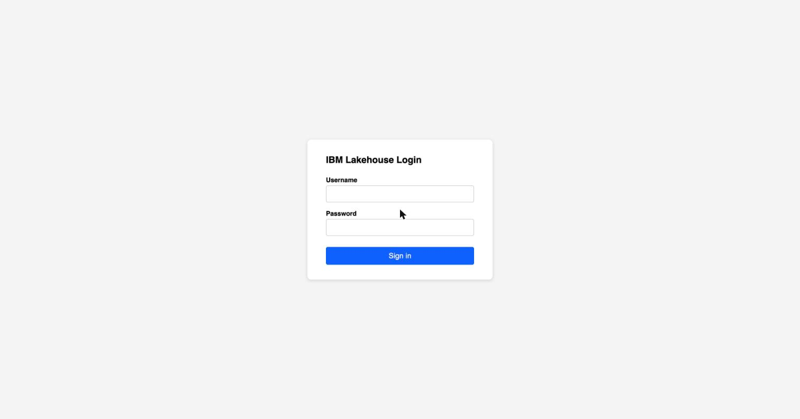
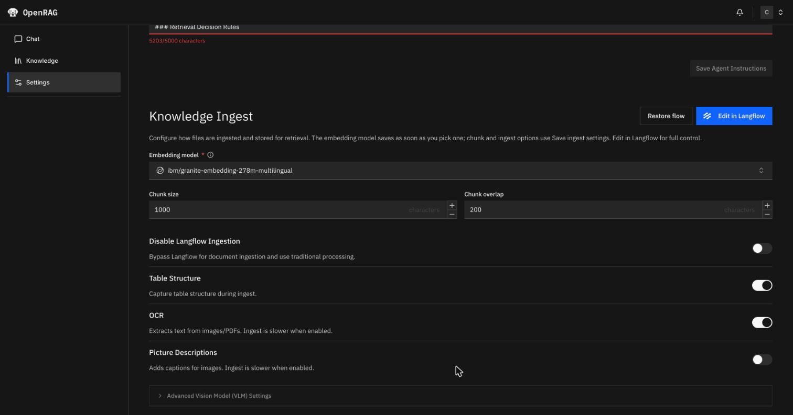
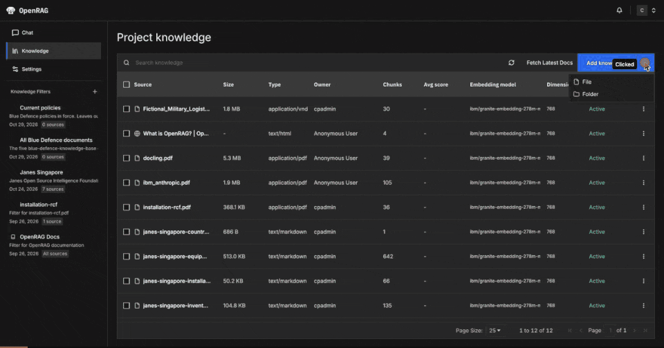
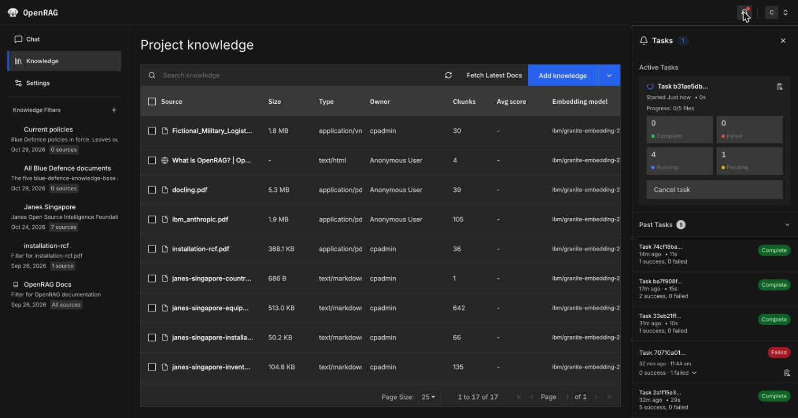
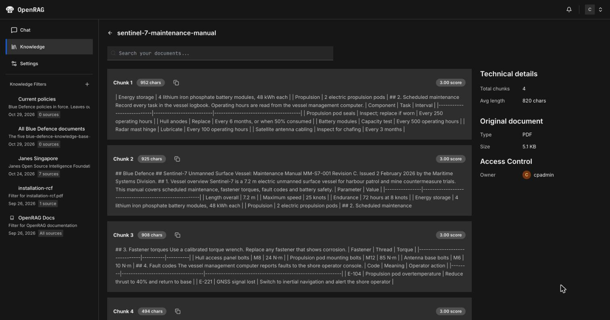
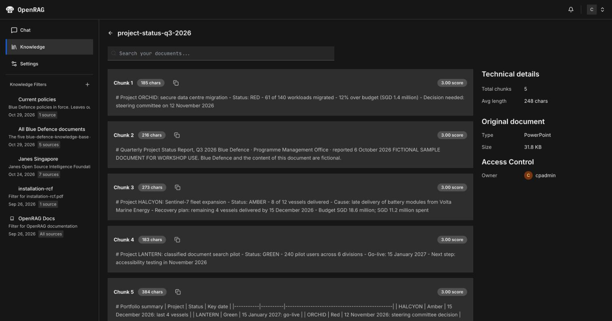
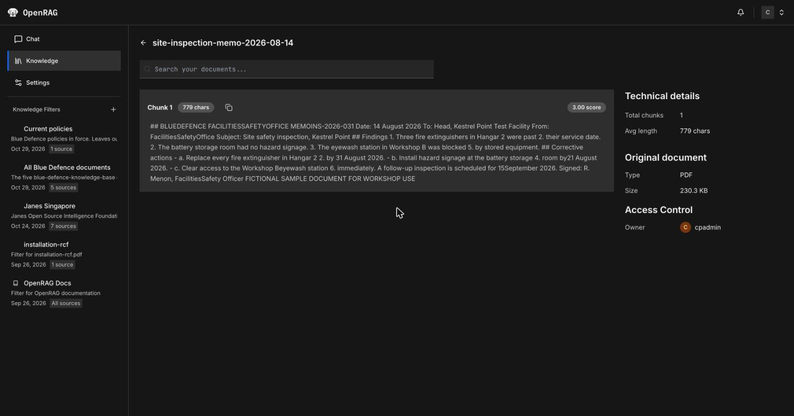
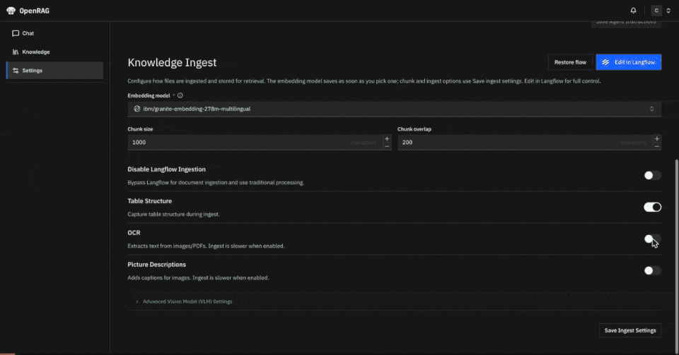

# Lab 1: Ingestion

20 minutes. You follow documents through ingestion in the order OpenRAG processes them:
Docling parses the Blue Defence documents, splits them into chunks, and reads a scanned
memo only with OCR on; the embedding model turns each chunk into a vector; and OpenSearch indexes the chunk
with its metadata.

**You need:** a Software Hub username and password with the OpenRAG `admin` role, which steps 4 and 5 need
to switch OCR, and the [`sample-docs`](../sample-docs/README.md) folder on your machine.

## 1. Sign in

1. Open OpenRAG at <https://openrag-fe-cpd.apps.itz-lfbzmf.infra01-lb.tok04.techzone.ibm.com>. You can
   also open watsonx.data from Software Hub at <https://cpd-cpd.apps.itz-lfbzmf.infra01-lb.tok04.techzone.ibm.com>
   and click the **OpenRAG** tile on the **Home** page.
2. Sign in on the **IBM Lakehouse Login** page with your Software Hub username and password.

   

3. Open **Settings** > **Langflow** and note the two models: the **Language model** under **Agent**,
   `meta-llama/llama-3-3-70b-instruct`, and the **Embedding model** under **Knowledge Ingest**,
   `ibm/granite-embedding-278m-multilingual`, both from watsonx.ai. **Knowledge Ingest** also holds the
   ingestion settings: chunk size 1,000 characters, chunk overlap 200, **Table Structure** on, **OCR** on,
   **Picture Descriptions** off.

   

The knowledge base already holds a few documents that OpenRAG ingested during onboarding, including the
OpenRAG documentation. You see those, plus anything you upload yourself. Documents that other users
upload are private to them.

## 2. Upload the knowledge base folder

1. Click **Knowledge**, click the arrow next to **Add knowledge**, then click **Folder**.
2. Select `sample-docs/blue-defence-knowledge-base`. The upload starts as soon as you select the folder,
   with the ingestion settings from **Settings**.
3. Click the bell icon at the top right to open **Tasks**. The upload appears under **Active Tasks** with
   its complete, failed, running and pending file counts, and moves to **Past Tasks** when it finishes.
   On the workshop cluster, the five files take about 30 seconds.

When it finishes, **Knowledge** lists these files:

| File | Chunks |
|---|---|
| approved-suppliers.csv | 2 |
| project-status-q3-2026.pptx | 5 |
| sentinel-7-maintenance-manual.pdf | 4 |
| security-clearance-policy-2024.docx | 2 |
| security-clearance-policy-2026.docx | 3 |

## 3. Look at the chunks

In **Knowledge**, click **⋮** at the end of each document's row below, then **View chunks**.

| Document | Look for |
|---|---|
| sentinel-7-maintenance-manual.pdf | The torque and fault code tables on page 2 are Markdown tables with one row per fastener or code. Table structure is on by default, so each torque stays in the row of its fastener through chunking. |
| project-status-q3-2026.pptx | One chunk per slide, with the slide title as a heading. |

Consecutive chunks overlap by up to 200 characters, so the end of one chunk repeats at the start of the
next. The chunk list is not in page order.

## 4. Upload it again with OCR on

1. Switch **OCR** back on in **Settings** > **Langflow** > **Knowledge Ingest** and click
   **Save Ingest Settings**. Leave it on for the rest of the workshop.
2. Upload the memo again.
3. Open **Tasks**. The task completes in about 10 seconds with 1 success.
4. Click **⋮** on the memo's row in **Knowledge**, then **View chunks**. The memo is 1 chunk. The text is
   there, with a few words run together, such as `MEMOINS-2026-031`, `FacilitiesSafety Officer` and
   `by21 August`, and list numbers in mid-sentence. OCR errors like these weaken keyword search for the
   affected terms; semantic search over the rest of the text still finds the memo.

OCR makes ingestion slower, and picture descriptions (which need OCR) make it more expensive.

## 5. What the index holds

OpenRAG stores each chunk as one document in the OpenSearch index `orag-documents`, with these fields:

| Field | Holds | Used for |
|---|---|---|
| `text` | The chunk as Markdown, with the torque and fault code tables as Markdown tables | Keyword search |
| `chunk_embedding_ibm_granite_embedding_278m_multilingual` | 768 numbers from the embedding model | Semantic (vector) search |
| `filename`, `mimetype`, `page` | The source file, its type and the page the chunk starts on | Citations; filters by data source and document type |
| `owner`, `allowed_users`, `allowed_groups` | Who uploaded the document and who else may read it | Document-level security |
| `connector_type`, `source_url` | `local` for an upload, or the connector the file came from | Filters by connector |
| `embedding_model`, `embedding_dimensions` | The model that produced the vector | Searching each chunk with the model that embedded it |
| `parser`, `chunk_size`, `chunk_overlap` | `Docling Serve 1.20.0` and the ingestion settings in force at upload | Tracing a chunk back to how it was made |

A search runs a keyword query on `text` and a vector query on the embedding field and combines the two
scores, which is why a score is not a value between 0 and 1. Each embedding model writes its own vector
field, so after a model change, older chunks keep the old model's vectors until they are uploaded again.

`scripts/openrag.py files` lists the chunk count, owner and connector of each document your account
can see.

---

Next: [Lab 2: Chat and retrieval control](lab-2-chat-and-filters.md)
