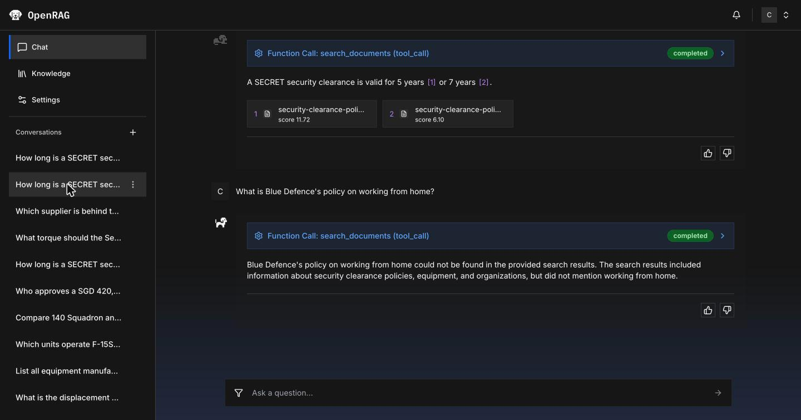
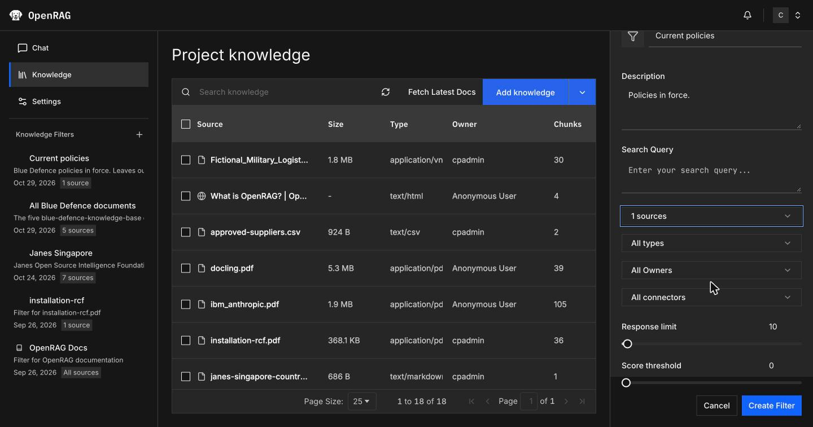
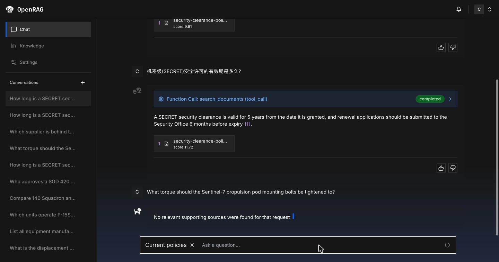
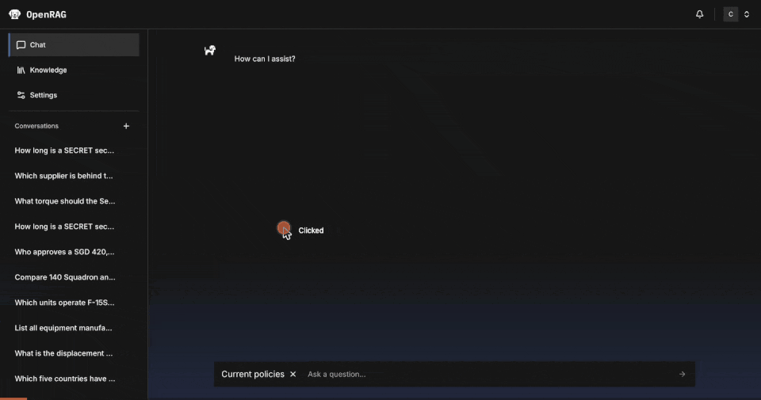

# Lab 2: Chat and retrieval control

45 minutes. You look at the Langflow flow that answers in **Chat**, test it with questions
whose answers sit in tables, slides and spreadsheets, then tune retrieval: a knowledge filter fixes a
conflict between two policy revisions, and the response limit decides which chunks reach the model.

**You need:** Lab 1 finished, so that your knowledge base holds the `blue-defence-knowledge-base` documents. For
step 6, [uv](https://docs.astral.sh/uv/) installed.

## 1. The agent flow in Langflow

**Chat** runs **OpenRAG OpenSearch Agent Flow**, a Langflow flow that the rest of this lab tests and tunes.
**Settings** > **Langflow** > **Agent** > **Edit in Langflow** opens it in Langflow, at
<https://openrag-lf-cpd.apps.itz-lfbzmf.infra01-lb.tok04.techzone.ibm.com>. The editor saves the flow within seconds and drops the binding of the Text Input below, and
**Chat** then ignores knowledge filters, which steps 4 and 5 use. The flow looks like this:


| Part of the flow | What it does |
|---|---|
| Agent | The language model with the system prompt. It decides on each turn whether to call a tool. |
| OpenSearch (Multi-Model Multi-Embedding) | Hybrid search over your chunks, offered to the agent as the tools `search_documents` and `raw_search`. The agent writes the search query itself. |
| Embedding Model (three of them) | Embed the agent's query with the model that embedded the chunks. |
| Text Input | Carries the knowledge filter selected in **Chat** (data sources, response limit, score threshold) into the OpenSearch component's **Search Filters (JSON)** input (`filter_expression`) and into the Prompt Template. OpenRAG fills it on each request through the global variable `OPENRAG-QUERY-FILTER`, so the editor shows it empty. |
| Prompt Template | Adds the selected knowledge filter to the agent's input. |
| Other tools | MCP Tools (the URL ingestion flow), the Calculator, and a search tool added for a separate demo. |

The system prompt tells the agent to retrieve when unsure, to cite chunk IDs, and to say "No relevant
supporting sources were found" when nothing matches. Step 2 tests that behaviour; steps 4 to 6 change what
reaches the OpenSearch component through `filter_expression`.

## 2. Ask questions across formats

Open **Chat** and ask each question.

| Question | Answer contains | From |
|---|---|---|
| What torque should the Sentinel-7 propulsion pod mounting bolts be tightened to? | 85 N·m | Torque table on page 2 of the maintenance manual (PDF) |
| Which supplier is behind the Project HALCYON delay, and when does its contract expire? | Volta Marine Energy; 30 June 2027 | The status deck (PowerPoint) names the supplier; the supplier register (CSV) holds the contract |
| What is Blue Defence's policy on working from home? | That no source covers it, in wording that varies: "No relevant supporting sources were found" or "could not be found in the provided search results" | No document covers it |

The last question checks that the agent says it has no source instead of inventing an answer.

Under each answer:

- Click a source card to see the chunk it came from, with its page, score, parser and chunking settings.
- Expand **Function Call: search_documents** to see the query the agent wrote (for the torque question,
  `Sentinel-7 propulsion pod mounting bolts torque`) and every chunk the search returned, with its file,
  page and score.


The HALCYON answer can come back without source cards even when it is right; the function call still
shows the chunks it used.

## 3. Ask about a policy with two revisions

Ask: **How long is a SECRET security clearance valid?**

The answer quotes 7 years, 5 years, or both. The knowledge base holds Revision 1 of the security clearance
policy (2024, 7 years) in the `archive` folder and Revision 2 (2026, 5 years) in `policies`, and both chunks
match the question. Search has no notion of which revision is current.



## 4. Create a knowledge filter

1. Click **Knowledge**, then **+** next to **Knowledge Filters** in the left sidebar. The **Knowledge
   Filter** panel opens on the right.
2. **Filter name:** `Current policies`. **Description:** `Policies in force.`
3. Open **All sources**, type `2026` in its search box, and select `security-clearance-policy-2026.docx`.
   The list then reads **1 sources**. Leave the types, owners and connectors at **All**, and the response
   limit and score threshold at their defaults (10 and 0).
4. Click **Create Filter**. The filter appears under **Knowledge Filters** with **1 source**.



[`../filters/current-policies.json`](../filters/current-policies.json) holds the same definition.

## 5. Ask again with the filter

1. Start a new chat with **+** next to **Conversations**, click the filter icon at the left of the
   question box, and select **Current policies**. The question box shows **Current policies** until you
   remove it.
2. Ask: **How long is a SECRET security clearance valid?** The answer is 5 years.
3. Ask: **Within how many hours of discovery must a security incident be reported?** The answer is 24 hours
   (Revision 1 said 72).
4. Ask the clearance question in Chinese: **机密级(SECRET)安全许可的有效期是多久?** The answer is 5 years,
   in English or Chinese. The embedding model is multilingual, so a question in Chinese retrieves the
   English document.
5. Ask: **What torque should the Sentinel-7 propulsion pod mounting bolts be tightened to?** The agent
   answers "No relevant supporting sources were found for that request": the maintenance manual is not in
   the filter.





A filter applied in **Chat** lasts for that chat session. Filters also narrow the document list on the
**Knowledge** page, which is a quick way to check what a filter includes.

## 6. Tune retrieval

A knowledge filter also sets how many chunks a search returns (**response limit**) and the lowest score a
chunk needs to be returned (**score threshold**). The filter applies them wherever it is used: in **Chat**,
in the search API, and in the MCP tools of Lab 3. In this step you look at the chunks and scores behind
one question and see what a lower response limit removes.

1. Create a second filter as in step 4. **Filter name:** `All Blue Defence documents`. **Sources:** the five
   files of `blue-defence-knowledge-base`. Leave the response limit at 10 and the score threshold at 0.
   ([`../filters/all-blue-defence-documents.json`](../filters/all-blue-defence-documents.json) holds the same definition.)
2. Search with it:

   ```bash
   export OPENRAG_URL=https://openrag-fe-cpd.apps.itz-lfbzmf.infra01-lb.tok04.techzone.ibm.com
   export OPENRAG_USERNAME=<username> OPENRAG_PASSWORD=<password>
   scripts/openrag.py search "Which supplier is behind the Project HALCYON delay, and when does its contract expire?" --filter "All Blue Defence documents"
   ```

   Each line is a chunk: its score, file and page. The answer needs two chunks: page 2 of
   `project-status-q3-2026.pptx` names Volta Marine Energy as the cause of the delay, and
   `approved-suppliers.csv` holds its contract expiry. The slide ranks third, below the supplier register
   and the deck's portfolio summary, which lists HALCYON as amber without naming a supplier.
3. Add `--limit 2` to the command. The slide is gone; the two chunks left cannot say which supplier
   delays HALCYON.
4. Search for **What is delaying Project HALCYON?** with the same filter and no `--limit`. The slide is now
   in the top two: the wording of a question changes the ranking as much as the settings do.

`--limit` overrides the filter's response limit for one search. To change the limit for **Chat**, edit it
in the filter.

## Points to discuss

- A filter scopes retrieval; it is not access control. Who can see a document is decided when it is
  uploaded: a local upload belongs to the user who uploaded it, and other users with the `user` role do
  not see it.
- The response limit (default 10 chunks) and the score threshold (default 0) trade recall against noise.
  Scores are hybrid search scores, not values between 0 and 1, so set a threshold by looking at the
  scores your documents produce.
- The chat agent writes its own search query from the question (for the HALCYON question, "Project
  HALCYON delay supplier and contract expiration"), so the chunks it gets can rank differently from a
  search on the question's exact words.
- Keeping superseded documents out of the knowledge base, or tagging them so a filter can exclude them,
  is a content-management decision that retrieval cannot make for you.

---

Next: [Lab 3: Agents over MCP](lab-3-agents-over-mcp.md)
