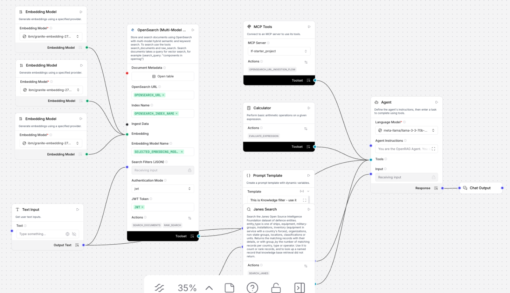
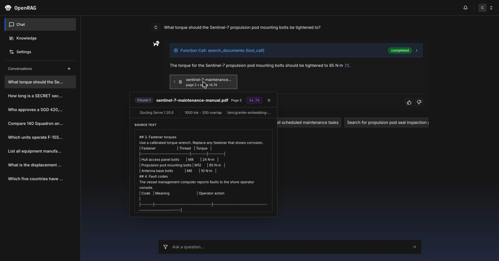
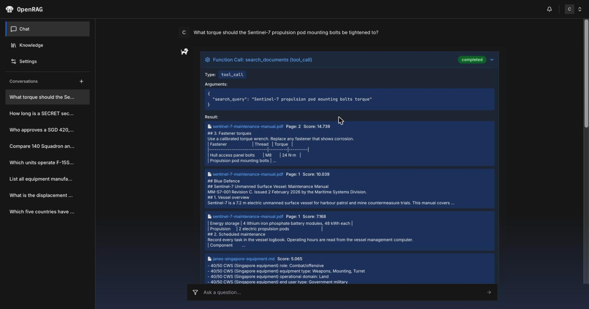
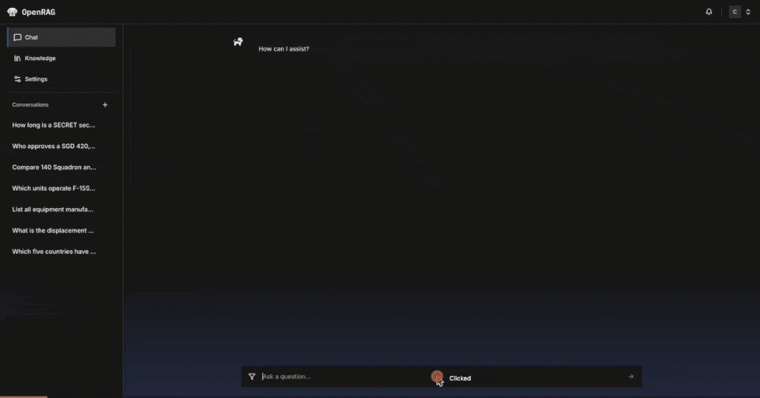

# Lab 2: Chat and retrieval control

20 minutes. You look at the Langflow flow that answers in **Chat**, test it with questions
chose answers sit in tables, slides and spreadsheets, then tune retrieval: a knowledge filter fixes a
conflict between two policy revisions, and the response limit decides which chunks reach the model.

**You need:** Lab 1 finished, so that your knowledge base holds the `blue-defence-knowledge-base` documents. For
step 6, [uv](https://docs.astral.sh/uv/) installed.

## 1. The agent flow in Langflow

**Chat** runs **OpenRAG OpenSearch Agent Flow**, a Langflow flow that the rest of this lab tests and tunes.
**Settings** > **Langflow** > **Agent** > **Edit in Langflow** opens it in Langflow, at
<https://openrag-lf-cpd.apps.itz-lfbzmf.infra01-lb.tok04.techzone.ibm.com>. The editor saves the flow within seconds and drops the binding of the Text Input below, and
**Chat** then ignores knowledge filters, which steps 4 and 5 use. The flow looks like this:

| Part of the flow | What it does |
|---|---|
| Agent | The language model with the system prompt. It decides on each turn whether to call a tool. |
| OpenSearch (Multi-Model Multi-Embedding) | Hybrid search over your chunks, offered to the agent as the tools `search_documents` and `raw_search`. The agent writes the search query itself. |
| Embedding Model (three of them) | Embed the agent's query with the model that embedded the chunks. |
| Text Input | Carries the knowledge filter selected in **Chat** (data sources, response limit, score threshold) into the OpenSearch component's **Search Filters (JSON)** input (`filter_expression`) and into the Prompt Template. OpenRAG fills it on each request through the global variable `OPENRAG-QUERY-FILTER`, so the editor shows it empty. |
| Prompt Template | Adds the selected knowledge filter to the agent's input. |
| Other tools | MCP Tools (the URL ingestion flow), the Calculator, and a search tool added for a separate demo. |

The system prompt tells the agent to retrieve when unsure, to cite chunk IDs, and to say "No relevant
supporting sources were found" when nothing matches. 

## 2. Ask questions across formats

Open **Chat** and ask each question.

| Question | Answer contains | From |
|---|---|---|
| What torque should the Sentinel-7 propulsion pod mounting bolts be tightened to? | 85 N·m | Torque table on page 2 of the maintenance manual (PDF) |
| What is Blue Defence's policy on working from home? | That no source covers it, in wording that varies: "No relevant supporting sources were found" or "could not be found in the provided search results" | No document covers it |

The last question checks that the agent says it has no source instead of inventing an answer.

Under each answer:

- Click a source card to see the chunk it came from, with its page, score, parser and chunking settings.
- Expand **Function Call: search_documents** to see the query the agent wrote (for the torque question,
  `Sentinel-7 propulsion pod mounting bolts torque`) and every chunk the search returned, with its file,
  page and score.

### 3. Controlling Retrieval

So far, we have looked at how OpenRAG retrieves relevant information from the knowledge base and uses that information as context when generating a response.

An important part of a RAG solution is being able to control **what information is considered during retrieval**.

This is where **Knowledge Filters** can be useful.

Knowledge Filters allow us to scope retrieval to a particular subset of the knowledge available to OpenRAG. Rather than every query searching across everything that has been ingested, retrieval can be restricted to the sources that are relevant for a particular use case.

This becomes particularly useful as the knowledge base grows and contains information across different domains, projects, document categories or other logical groupings.

The underlying content does not need to change. Instead, the filter determines the scope of knowledge that is considered during retrieval.

Knowledge Filters can also be used together with retrieval settings such as:

- **Response limit** — controls the maximum number of chunks returned by the search.
- **Score threshold** — controls the minimum search score required for a chunk to be returned.

These settings influence how much retrieved context is ultimately made available to the model.

The **response limit** is particularly important because enterprise questions may require information from multiple pieces of content. If the limit is too restrictive, relevant information may fall outside the results returned to the model.

The **score threshold** provides another level of control by determining the minimum relevance required before retrieved content is included.

Another important consideration is that retrieval is influenced by the **query itself**. Different ways of expressing the same underlying question can result in different chunks being retrieved or ranked differently.

In **Chat**, OpenRAG can formulate a search query based on the user's question. The retrieval process then identifies and ranks relevant chunks, and those retrieved chunks provide the context used by the model to generate its answer.

So overall, there are several layers influencing what ultimately reaches the model:

1. **Knowledge base content** determines what information is available.
2. **Knowledge Filters** determine the scope of knowledge considered during retrieval.
3. **Retrieval settings** influence which and how many chunks are returned.
4. **The search query** influences the relevance and ranking of those chunks.
5. **Retrieved context** provides the grounding used by the model when generating its response.

The key point is that RAG is not simply about loading documents and asking questions. We also have mechanisms to control and tune the retrieval process so that the model receives the most appropriate context for the task.

> **Note:** Knowledge Filters should be viewed as a retrieval control rather than an access-control mechanism. They determine what information is considered during retrieval; authorization and access control should be managed separately.
---

Next: [Lab 3: Agents over MCP](lab-3-agents-over-mcp.md)
