# Lab 4: Build a low-code agent

40 minutes. You build the same RAG agent two ways in the watsonx Orchestrate agent builder,
both over OpenRAG's MCP tools: a policy assistant that calls the tools itself, with the model deciding what
to search, and a workflow agent that hands every question to an agentic workflow that searches in fixed
steps. Lab 5 evaluates and improves the policy assistant; Lab 6 compares the two in their traces.

**You need:** Lab 3 finished, and access to the workshop's Orchestrate instance at
<https://ca-tor.watson-orchestrate.cloud.ibm.com> with the Writer (builder) role.

## 1. Connect Orchestrate to OpenRAG

Your agents reach OpenRAG through an MCP toolkit and a connection that holds OpenRAG credentials.
[`../orchestrate/setup-agent.sh`](../orchestrate/setup-agent.sh) creates them with the watsonx Orchestrate
Agent Development Kit (ADK) command-line interface.

1. Install the ADK:

   ```bash
   uv tool install ibm-watsonx-orchestrate==2.19.1
   ```

2. In watsonx Orchestrate, click your user icon, then **Settings** > **API details**. Copy the service
   instance URL and generate an API key. Add and activate an environment for the instance:

   ```bash
   orchestrate env add -n openrag-workshop -u <service instance URL> --type ibm_iam
   orchestrate env activate openrag-workshop --api-key <API key>
   ```

3. Run the setup with your OpenRAG account:

   ```bash
   export OPENRAG_URL=https://openrag-fe-cpd.apps.itz-lfbzmf.infra01-lb.tok04.techzone.ibm.com
   export OPENRAG_AGENT_USERNAME=<username> OPENRAG_AGENT_PASSWORD=<password>
   orchestrate/setup-agent.sh
   ```

   On a new instance, the toolkit creation right after the connection is set up can fail with 401
   "Invalid authentication credentials". Run the script again.

The script creates these objects. Your agents reuse the first two.

| Object | Name | What it is |
|---|---|---|
| Connection | `openrag_mcp` | Key-value connection with team credentials: `x-username` and `x-api-key`, which Orchestrate sends as request headers. Every agent that uses the toolkit signs in to OpenRAG as the same user. |
| Toolkit | `openrag` | Remote MCP server `https://openrag-fe-cpd.apps.itz-lfbzmf.infra01-lb.tok04.techzone.ibm.com/mcp` over streamable HTTP, importing only `openrag_search` and `openrag_search_knowledge_filters`, the tools you called in Lab 3 |
| Agent | `blue_defence_policy_assistant` | The reference agent, with the instructions and guideline your policy assistant ends Lab 5 with |
| Agentic workflow | `policy_answer` | The reference for the workflow you build in step 6, built with the ADK from [`../orchestrate/policy-answer-workflow.py`](../orchestrate/policy-answer-workflow.py) |

In the Orchestrate UI, the same toolkit is added from an agent's **Tools** > **Add tool** > **MCP server** >
**Add MCP server** > **Remote MCP server**, with the URL, **Streamable HTTP**, and a key-value connection
holding the two headers.

The toolkit signs in to OpenRAG as the account you gave the script, so your agents search that account's
documents and filters: the documents you uploaded in Lab 1 and the filters you created in Lab 2.

## 2. Create the policy assistant

1. Open the Orchestrate URL. From the main menu, click **Active inventory** > **Agents**, then
   **Create agent**.
2. Click **Create from scratch**. The builder opens on a new agent named **Untitled Agent 1**, with
   **Build**, **Evaluate** and **Deploy** at the top, the **Behavior**, **Knowledge**, **Tools** and
   **Agents** sections on the left, and **Draft Preview** on the right.
3. Under **Behavior** > **Profile**, set:

   | Field | Value |
   |---|---|
   | Agent name | `<your initials> Policy Assistant` |
   | Model | GPT-OSS 120B — OpenAI (via Groq), the default and the model of the reference agent |
   | Description | `Answers questions about Blue Defence policies, the Sentinel-7 maintenance manual, project status reports and registers from the OpenRAG knowledge base.` |
   | Instructions | The text below |

   ```text
   Answer only from the OpenRAG knowledge base. For every question, call openrag_search with the question
   as the query and a limit of 5, then answer from the returned chunks and name the file each fact comes
   from. If the chunks do not contain the answer, say that the knowledge base has no information on it.
   ```

   Each field saves when you click outside it; there is no save button.

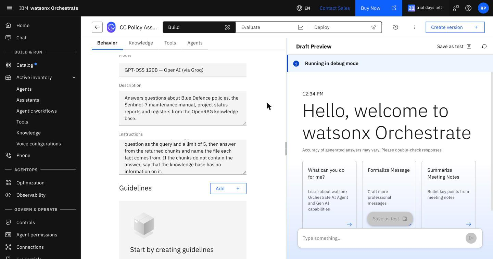

## 3. Add the OpenRAG tools

1. Click **Tools**, then **Add Tool** > **Local instance**.

   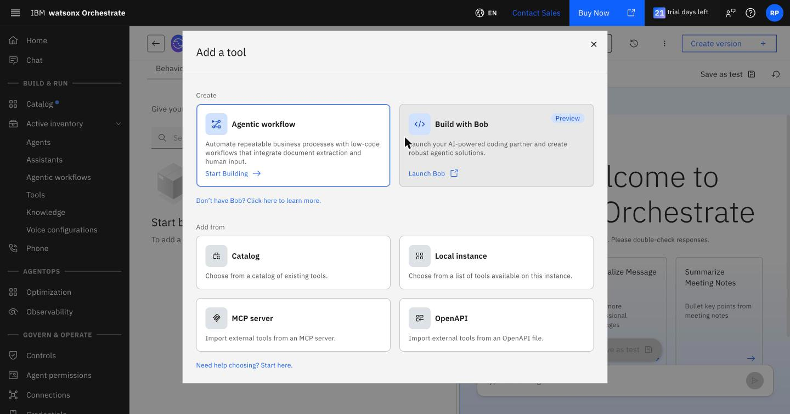

2. Search for `openrag` and select `openrag:openrag_search` and
   `openrag:openrag_search_knowledge_filters`. The instance also holds other toolkits and the
   reference `Policy answer` workflow; leave them out.
3. Click **Add to agent**. Both tools appear with the type **MCP**.

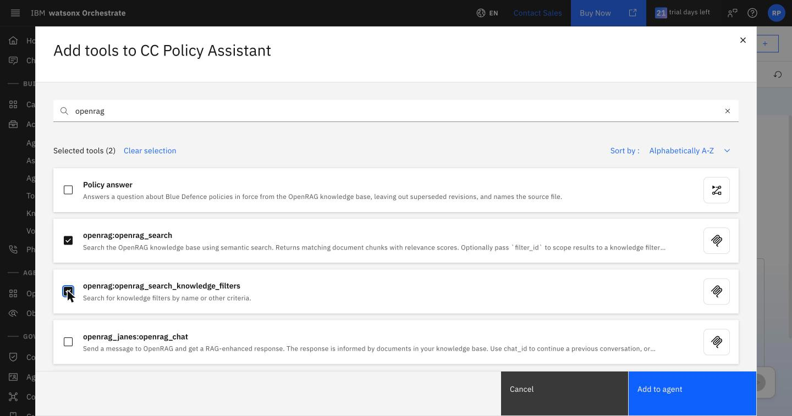

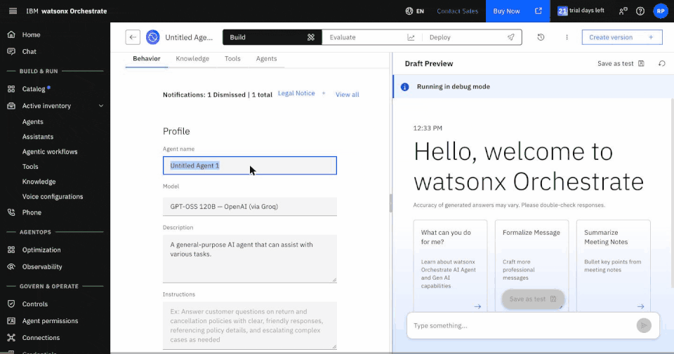

These are MCP tools: when the agent calls one, Orchestrate opens a session with
`https://openrag-fe-cpd.apps.itz-lfbzmf.infra01-lb.tok04.techzone.ibm.com/mcp`, sends
the connection's two headers, and returns the tool's result to the agent. The toolkit holds only the two
read-only tools, so the agent cannot change OpenRAG's settings or delete documents.

## 4. Try the policy assistant

Ask these in **Draft Preview**:

| Question | Answer |
|---|---|
| What torque should the Sentinel-7 propulsion pod mounting bolts be tightened to? | 85 N·m, from the maintenance manual |
| Which supplier is behind the Project HALCYON delay, and when does its contract expire? | Volta Marine Energy, 30 June 2027 |
| What is Blue Defence's policy on working from home? | The knowledge base has no information on it |
| How long is a SECRET security clearance valid? | 7 years, 5 years, or both |

Click **Show Reasoning** under an answer, then **Step 1**, to see the tool the agent called and the input it
chose.

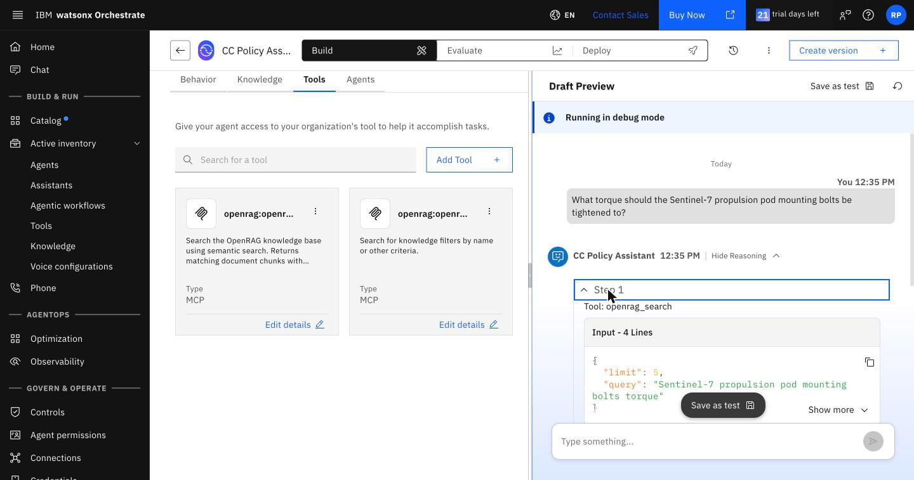

The clearance answer varies for the reason it varied in Lab 2 step 3: nothing in the instructions makes the
model use the `Current policies` filter, so its search returns both revisions of the security clearance
policy, and the answer can quote the superseded one. The workflow agent you build next always applies the
filter; Lab 5 fixes the policy assistant and measures the result.

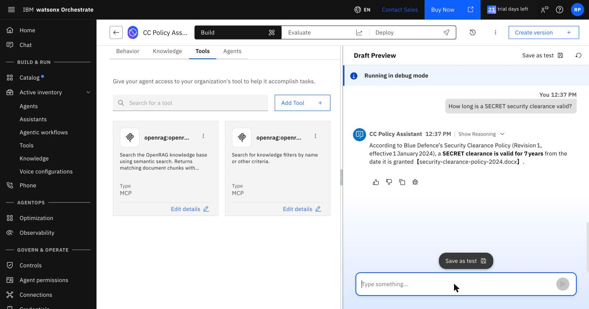

## 5. Create the workflow agent

1. Create a second agent from scratch. **Agent name:** `<your initials> Policy Workflow`. **Description:**
   `Answers questions about Blue Defence policies in force through the policy answer workflow.`
2. Keep the model GPT-OSS 120B and enter these instructions:

   ```text
   For every question, run the <your initials> policy answer workflow with the user's question and return
   its answer unchanged.
   ```

## 6. Build the agentic workflow

An agent decides at run time which tools to call and with what arguments. An agentic workflow runs the same
steps every time. This one always searches with the `Current policies` filter, then writes the answer with
a generative prompt.

1. In the workflow agent, click **Tools**, then **Add Tool** > **Agentic workflow** > **Start Building**.
   Under **Name your agentic workflow**, enter `<your initials> policy answer` and click **Start building**.
   The flow builder opens with a start node, an **Add your first step** placeholder and an end node.
2. Click the gear next to the workflow name to open **Flow settings**:
   - **General** > **Description:** `Answers a question about Blue Defence policies in force from the
     OpenRAG knowledge base and names the source file.` The agent reads this to decide when to run the
     workflow.
   - **Parameters** > **Add input** > **String:** name `question`, description
     `A question about Blue Defence policies`, **Required** on.
   - **Parameters** > **Add output** > **String:** name `answer`, description
     `The answer, naming the file each fact comes from`.

   Close **Flow settings**.

   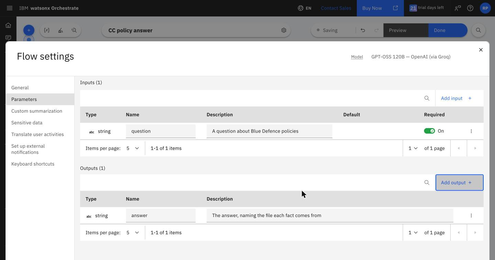

3. Click **Add your first step** > **Call a tool**. From the **Tools** palette, drag
   `openrag:openrag_search` onto **Add your first step**. Close the palette, click the new node, then click
   **Edit data mapping**. Each input starts on **Auto-map**; click **Remove all auto-mapping**, then set:

   | Input | Value |
   |---|---|
   | `query` | Click **{x}** > **Input** > `question` |
   | `limit` | `5` |
   | `filter_id` | The id of your `Current policies` filter, which you noted in Lab 3 step 3 |

   Leave `filters` and `score_threshold` empty, and close the panel.

   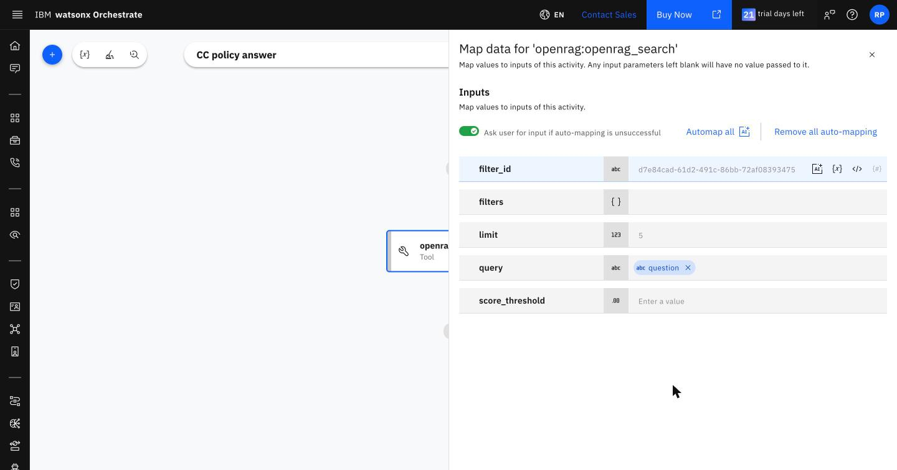

4. Hover over the connector below the search node, click **+**, then **Add a flow activity** >
   **Generative prompt**.

   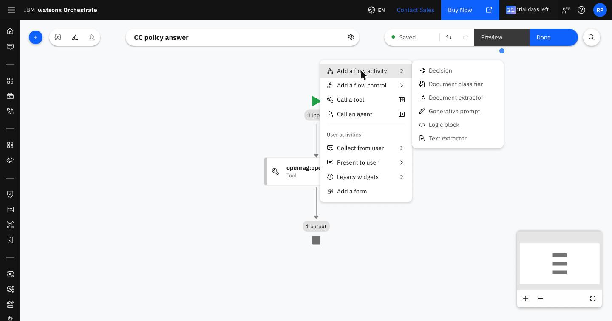

   In the **Generative prompt** editor, keep the model GPT-OSS 120B and:
   - Under **Input**, click **Add** > **String** twice, for `question` (`The user's question`) and
     `chunks` (`Chunks returned by OpenRAG search`).
   - **System prompt:** `You answer questions about Blue Defence policies. Use only the supplied chunks.
     Name the file each fact comes from. If the chunks do not contain the answer, say that the knowledge
     base has no information on it.`
   - **User prompt:** type `Question: `, click **{x}** > **Generative prompt** > `question`, type
     ` Chunks: `, then click **{x}** > **Generative prompt** > `chunks`.

   Close the editor.

   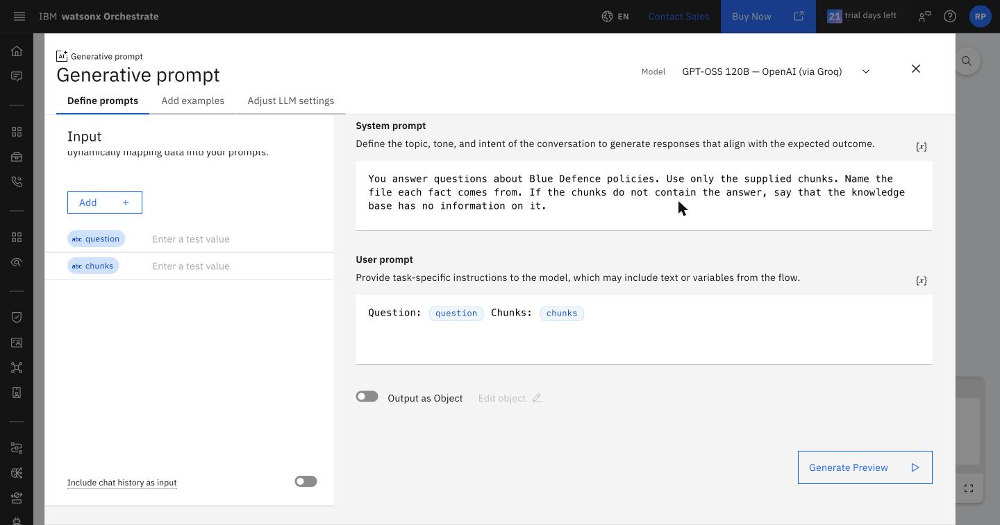

5. Click the **Generative prompt** node, click the pencil next to its name and rename it
   `Write the answer`. Click **Edit data mapping** > **Remove all auto-mapping**, then map `question` to
   **Input** > `question` and `chunks` to **openrag:openrag_search** > `output`.
6. Click the end node (**1 output**) > **Edit data mapping** > **Remove all auto-mapping**, and map
   `answer` to **Write the answer** > `value`.
7. Click **Done**. The workflow appears in the agent's **Tools** with the type **Agentic Workflow**.

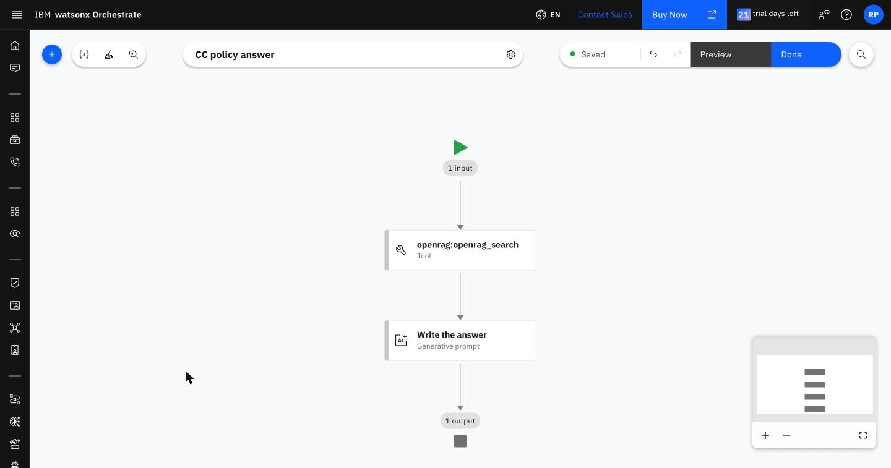

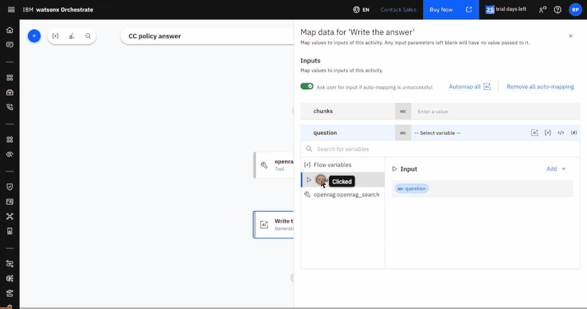

If your workflow does not run, remove it from the agent and add the reference `Policy answer` from
**Add Tool** > **Local instance** instead; change the instructions to name it.

## 7. Try the workflow agent

Ask in the workflow agent's **Draft Preview**:

| Question | Answer |
|---|---|
| How long is a SECRET security clearance valid? | 5 years, from `security-clearance-policy-2026.docx`, every time |
| Within how many hours of discovery must a security incident be reported? | 24 hours |
| What torque should the Sentinel-7 propulsion pod mounting bolts be tightened to? | The knowledge base has no information on it |

The chat shows the workflow's `flow_output`, then the agent's answer. The workflow takes about 9 seconds:
about 8 for the OpenRAG search through MCP and under 1 for the generative prompt. The torque question shows
the other side of fixed steps: the workflow only ever searches the current policies, so it cannot answer
from the maintenance manual.

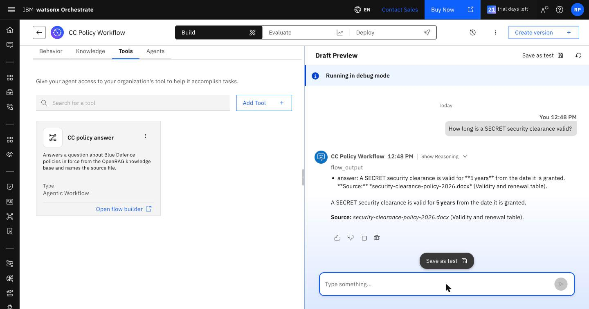

## Agent or workflow

| | Policy assistant (agent with tools) | Workflow agent (agentic workflow) |
|---|---|---|
| Which tools run, with which arguments | The model decides on each turn, guided by the instructions | Fixed when the workflow is built |
| Knowledge filter | Applied when the instructions or a guideline lead the model to apply it | Always applied |
| Questions outside the current policies | Answered from any document the account can see | Not answered: the filter is fixed |
| Change it by | Editing the instructions and guidelines | Editing the workflow in the builder or the ADK file |
| Suits | Questions that need different tools or several searches | A step sequence that must not vary, such as a lookup that must use the current revisions |

## Points to discuss

- A common design combines the two: an agent that answers most questions with its tools and calls a
  workflow for the questions whose steps must not vary.
- The generative prompt's model is set in the workflow, separately from the agent's model.
- [`../orchestrate/policy-answer-workflow.py`](../orchestrate/policy-answer-workflow.py) is the same workflow
  as Python: `aflow.tool("openrag:openrag_search")` for the tool node and `aflow.prompt(...)` for the
  generative prompt. It is imported with `orchestrate tools import -k flow`.

---

Next: [Lab 5: Evaluate and improve the agent](lab-5-evaluate-and-improve.md)
