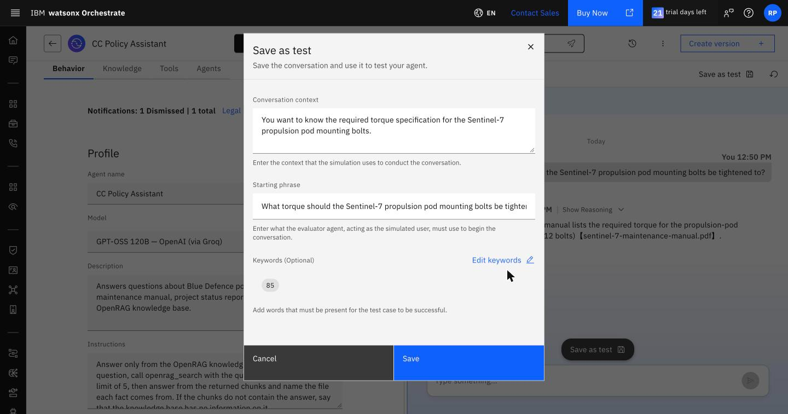
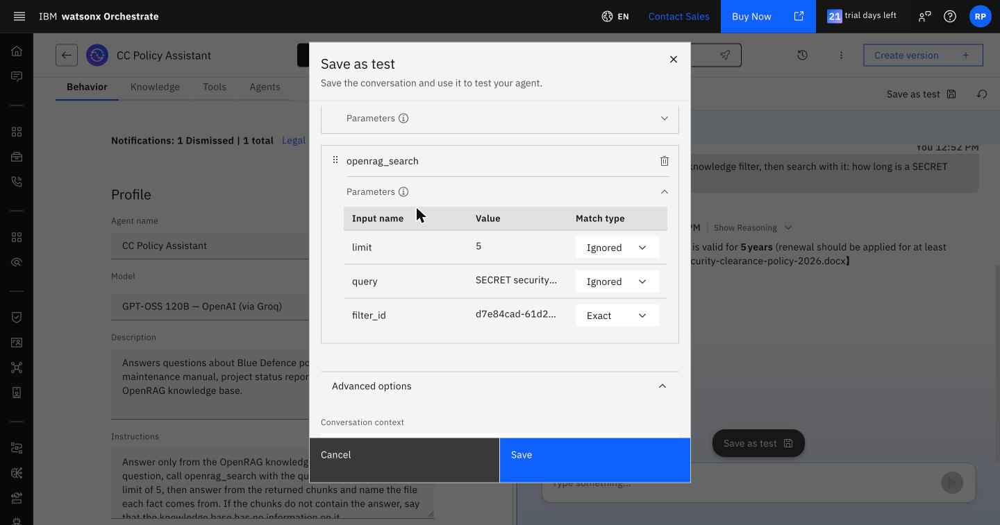
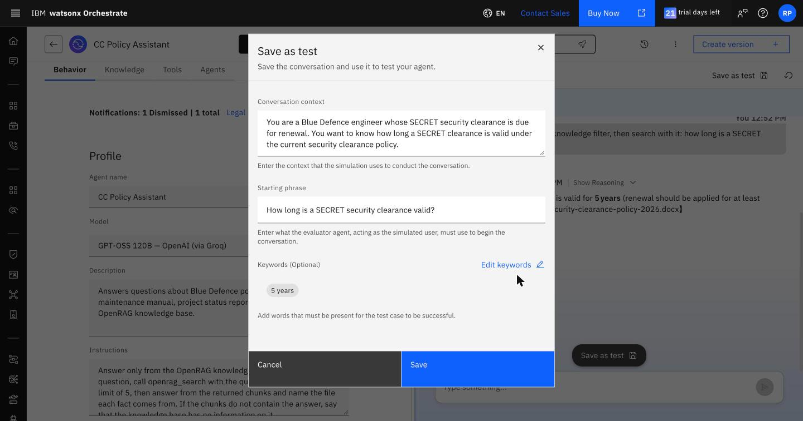
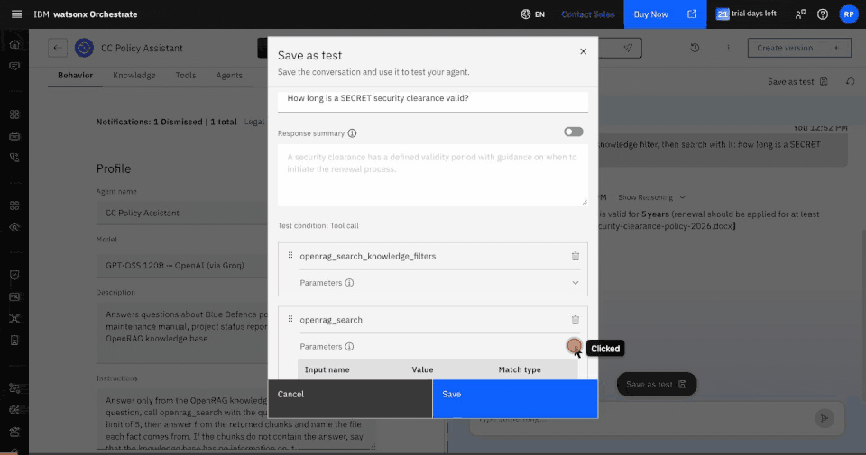
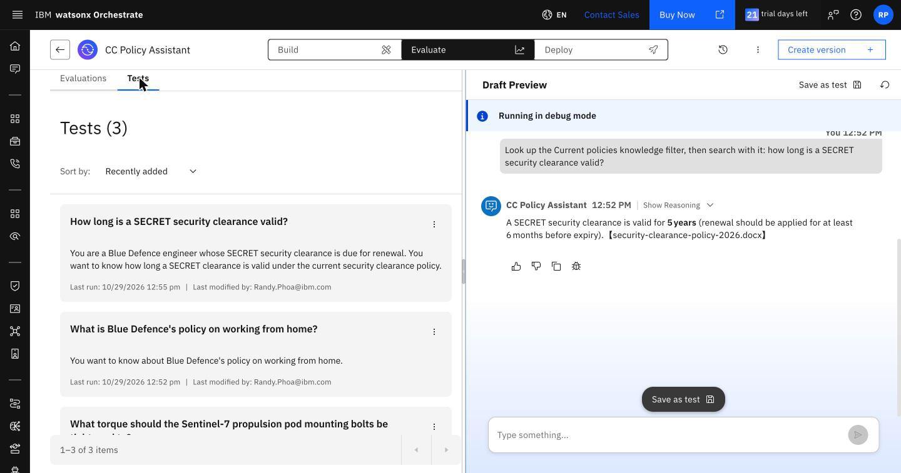
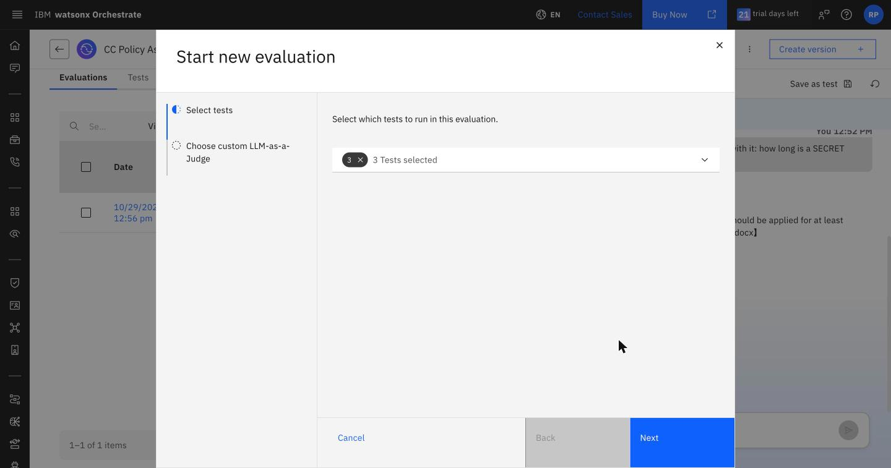
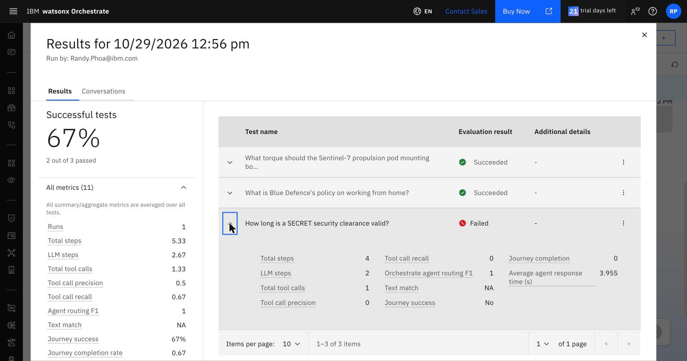
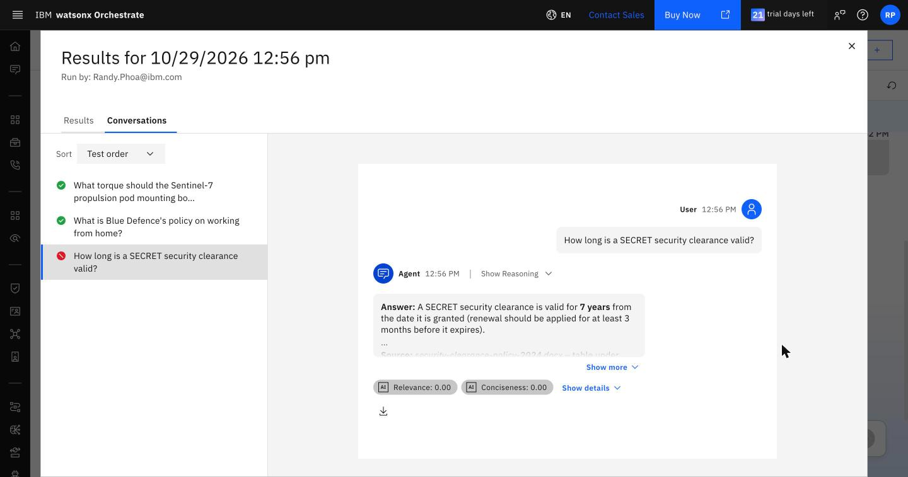
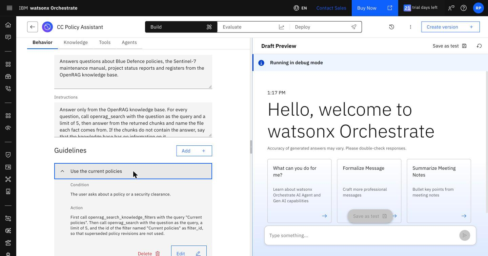
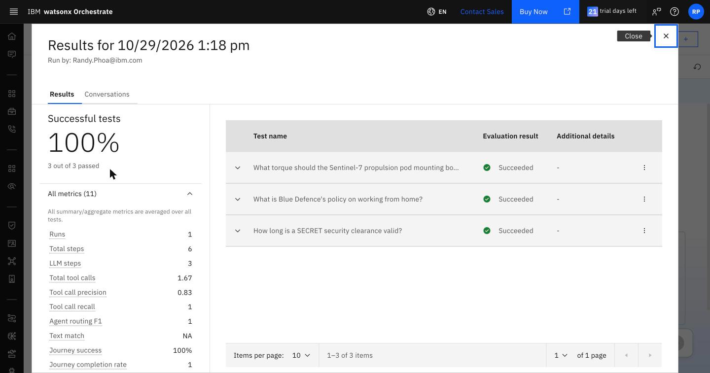

# Lab 5: Evaluate and improve the agent

25 minutes. You record test cases for the policy assistant from its preview chat, run an
evaluation in which a simulated user talks to it, find the case that fails, add a guideline, and run
the evaluation again. The policy assistant is the agent to evaluate because its behaviour depends on its
instructions; the workflow agent's steps are fixed.

**You need:** your `<your initials> Policy Assistant` from Lab 4, with the instructions of Lab 4 step 2.

## 1. Record three test cases

A test case holds a starting question, the tool calls the agent should make, and what the answer must say.
Record each from a conversation in **Draft Preview**:

1. Click the reset icon (↻) at the top right of **Draft Preview**. **Save as test** records every tool call
   in the preview conversation, so each test needs a fresh one.
2. Ask the question and wait for the answer.
3. Click **Save as test**, review the extracted test, make the changes in the table below, and click
   **Save**.

| Ask | Then, before saving |
|---|---|
| What torque should the Sentinel-7 propulsion pod mounting bolts be tightened to? | **Advanced options** > **Keywords** > **Edit keywords** > **Add keyword:** `85` |
| What is Blue Defence's policy on working from home? | No changes |
| Look up the Current policies knowledge filter, then search with it: how long is a SECRET security clearance valid? | See below |

The last question asks for the behaviour the agent should show without being asked. Check that **Test
condition: Tool call** lists `openrag_search_knowledge_filters` and then `openrag_search`, and delete any
other call with its bin icon. Then edit the test before saving it:

1. **Name:** `How long is a SECRET security clearance valid?`
2. Expand the parameters of `openrag_search` and set the match type of `filter_id` to **Exact**, and of
   `query` and `limit` to **Ignored**.
3. **Advanced options** > **Conversation context:** `You are a Blue Defence engineer whose SECRET security
   clearance is due for renewal. You want to know how long a SECRET clearance is valid under the current
   security clearance policy.`
4. **Starting phrase:** `How long is a SECRET security clearance valid?`. The simulated user opens with
   this question instead of the one you typed.
5. **Keywords:** `5 years`.

For each tool parameter, **Exact** needs the same value, **Fuzzy** accepts a similar value, and **Ignored**
does not check it. The extracted test sets `limit` to **Exact**, `query` to **Fuzzy** and `filter_id` to
**Ignored**. A test passes when the expected tools are called with matching parameters and every keyword is
in the answer. With **Response summary** on, the answer must also be close in meaning to the summary;
these tests leave it off.

**Evaluate** > **Tests** lists the three tests.

## 2. Run the evaluation

1. Click **Evaluate** > **Evaluations** > **Start new evaluation**. Under **Select tests**, open the list,
   choose **Select all**, and click **Next**. A custom LLM-as-a-Judge is optional; click **Run**.

   

2. A simulated user, played by a language model, opens each conversation with its starting phrase and
   answers the agent's follow-up questions. The run takes about a minute. When its status is
   **Complete**, open it by its date.

The torque and working-from-home tests succeed. The clearance test fails: the agent searched without looking
up the filter, so the expected call to `openrag_search_knowledge_filters` is missing and the
`openrag_search` call has no `filter_id`. Its answer can still say 5 years, because the model sometimes
picks the 2026 revision after reading both. The tool-call check catches the missing filter even when the
text happens to be right.

**All metrics** averages over the tests; expand a test to see its own values:

| Metric | Meaning |
|---|---|
| Tool call recall | Share of the expected tool calls that the agent made |
| Tool call precision | Share of the agent's tool calls that were expected |
| Text match | Whether the answer matches the response summary in meaning; NA when the test has none |
| Journey success | Whether the test met all of its conditions |
| Average agent response time | Seconds per agent response |

Click **⋮** on a test, then **View conversation**, to see the conversation, the tool calls under
**Show Reasoning**, and AI-scored measures such as relevance.

## 3. Add a guideline and run again

A guideline is a rule with a condition and an action that the agent applies when the condition holds. The
agent applies a guideline more consistently than a rule written as another paragraph of the
instructions, where the first sentence, "For every question, call openrag_search…", wins and the agent
searches once without the filter.

1. Click **Build** > **Behavior**. Under **Guidelines**, click **Add** and enter the guideline that the
   reference agent `blue_defence_policy_assistant` uses:

   | Field | Value |
   |---|---|
   | Name | `Use the current policies` |
   | Condition | `The user asks about a policy or a security clearance.` |
   | Action | `First call openrag_search_knowledge_filters with the query "Current policies". Then call openrag_search with the question as the query, a limit of 5, and the id of the filter named "Current policies" as filter_id, so that superseded policy revisions are not used.` |

2. Click **Save**.

   

3. Start a new evaluation with all three tests and open the new run. All three tests succeed.

Change one thing at a time and rerun the same tests, so that a change in the results has one cause.

## Points to discuss

- A few passing tests give false confidence. Cover every tool, every kind of question the agent answers, a
  question it must decline, and natural variations of each question.
- The simulated user and the agent's model both vary between runs, so run an evaluation more than once
  before trusting a change of a single test. On the workshop instance, the filter rule written as an
  instruction paragraph failed the clearance test in most runs; written as a guideline, it passed in every
  run.
- An extra tool call lowers precision without failing a test: with the guideline, the agent also looks
  up the filter for the working-from-home question, which mentions a policy, so its precision is 0.5.
  Whether that is wrong is a decision about the test.
- Tests encode the expected design. Tests for the workflow agent would expect a call to the workflow
  instead of the two OpenRAG tools.

---

Next: [Lab 6: Observability and control](lab-6-observability-and-control.md)
