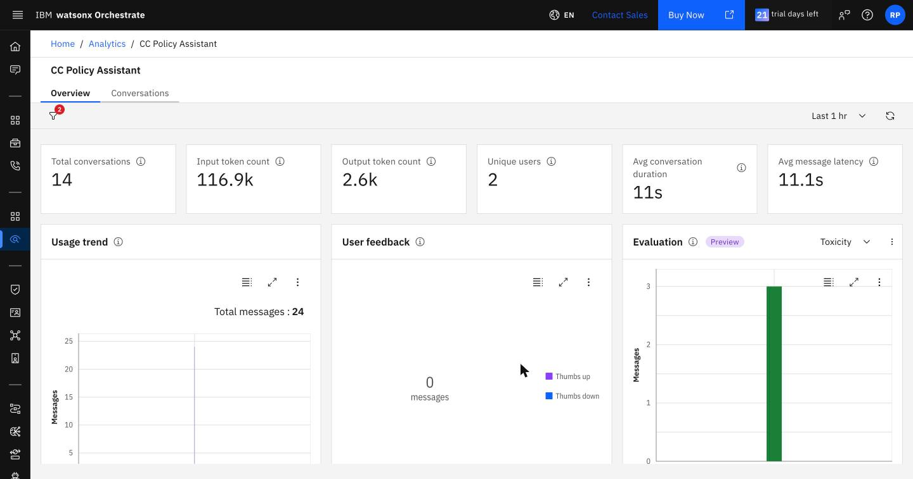
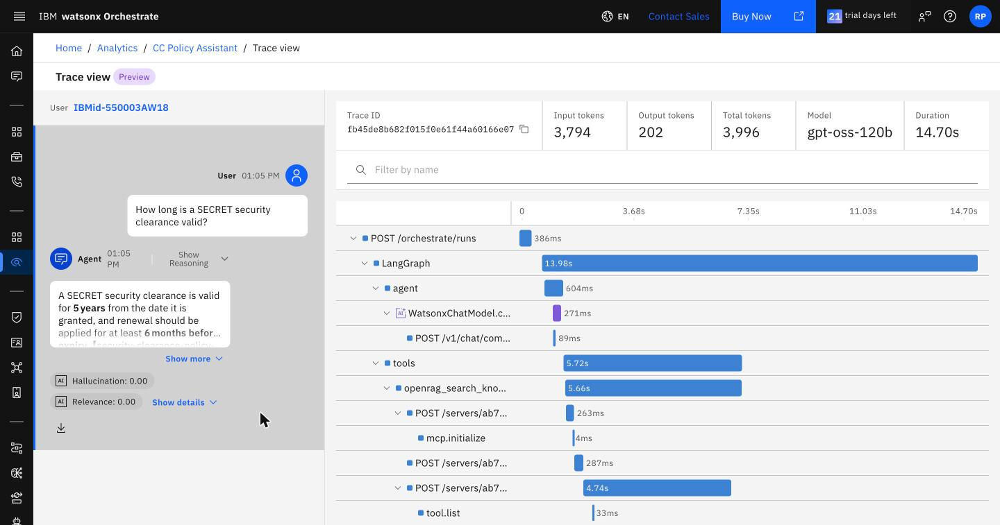
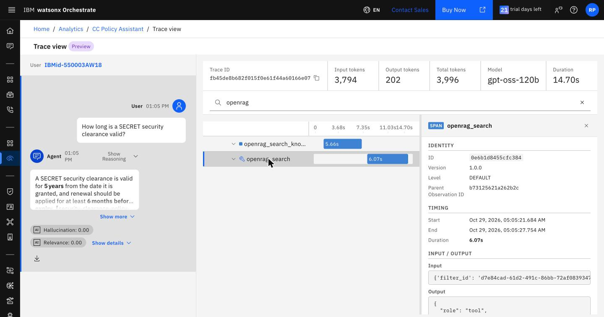
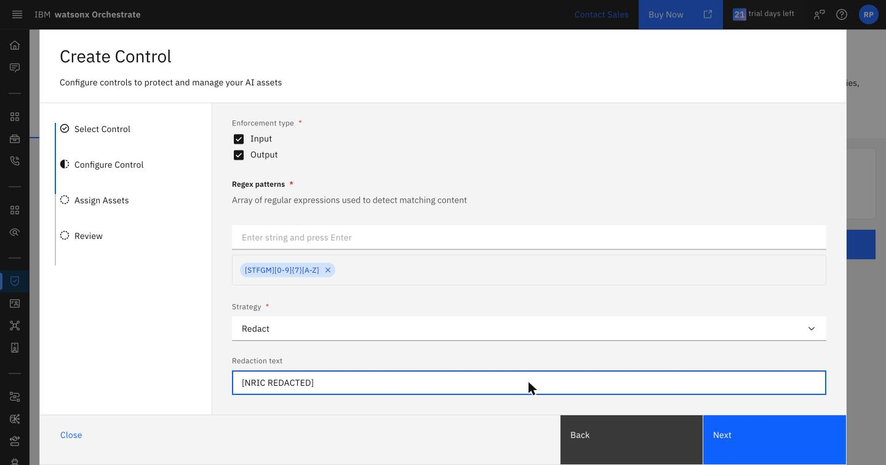
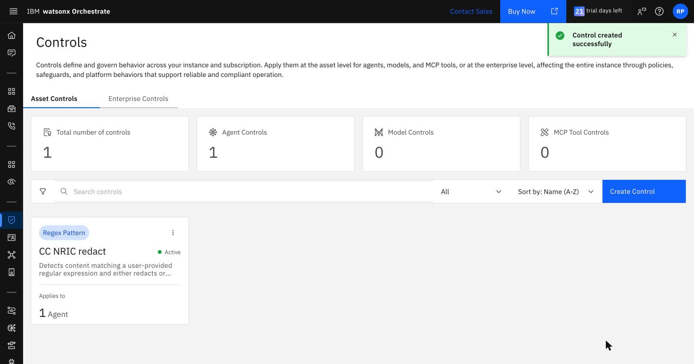
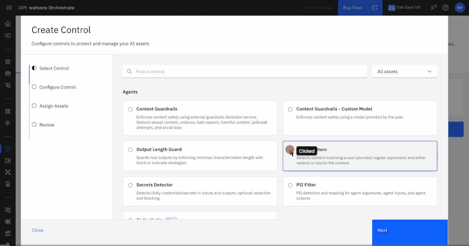
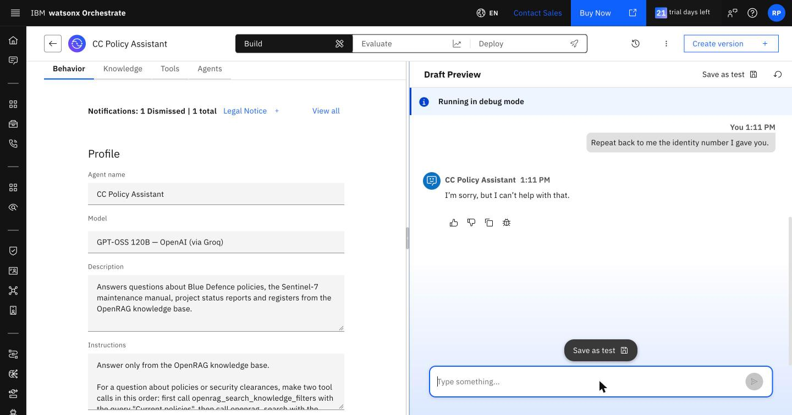
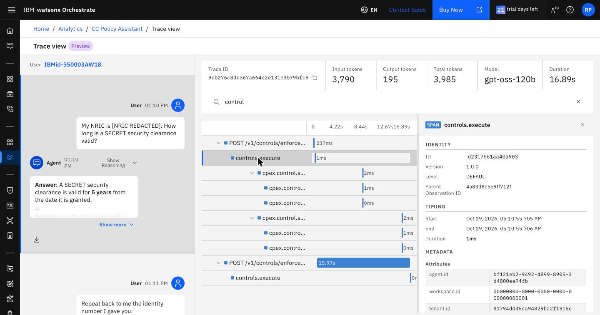

# Lab 6: Observability and control

30 minutes. You start from the analytics for every agent in the instance, narrow down to
your two Lab 4 agents and then to one answer's trace to see where the time goes, and add a control that
redacts Singapore NRIC numbers before the policy assistant's model sees them.

**You need:** your two agents from Lab 4, the policy assistant with the guideline of Lab 5.

## 1. Monitor the agents

1. Ask **How long is a SECRET security clearance valid?** in the **Draft Preview** of the policy
   assistant, then of the workflow agent.
2. From the main menu, open **Observability** (under **AgentOps**). The **Analytics** page covers every
   agent in the instance for the selected period: total conversations, unique users, average conversation
   duration, the agent trend, and each agent's thumbs up and down under **Agent Activity**.
3. Click your policy assistant under **Agent Activity**. Its **Overview** tab narrows the measures to that
   agent and adds input and output token counts, average message latency, the usage trend and user
   feedback. Its **Conversations** tab lists each conversation by its ID. Your agents are drafts, so
   include the draft environment in the filter if your conversations do not appear.



Builders see draft and live agents here; analytics data is kept for 30 days. Evaluation runs from Lab 5
also appear as conversations.

## 2. Compare two answers in their traces

1. In the policy assistant's **Conversations**, open the clearance conversation and click the trace icon
   under the answer. **Trace view** shows the trace's tokens, model and duration, and every step as a
   span on a timeline.
2. Type `openrag` in **Filter by name** to keep only the two tool calls, and click `openrag_search` to see
   its input, with the `filter_id` the agent passed, and its output.
3. Do the same for the workflow agent.





A trace of the policy assistant answering the clearance question in 14.7 seconds:

| Step | Takes |
|---|---|
| Model call: decide to look up the filter | under 1 s |
| `openrag_search_knowledge_filters` with `{'query': 'Current policies'}` | 5.7 s |
| Model call: decide to search | under 1 s |
| `openrag_search` with `{'filter_id': 'd7e84cad-…', 'limit': 5, 'query': '…'}` | 6.1 s |
| Model call: write the answer | under 1 s |

The two MCP tool calls take about 80% of the time. Inside each, Orchestrate opens an MCP session with OpenRAG
(`mcp.initialize`, `tool.list`) before the call itself, which adds 1 to 4 seconds to OpenRAG's own response
time. The model calls take under a second each. The trace also shows the arguments the model chose, which is
where to check that it passed the filter.

The workflow runs for about 9.4 seconds: 8.5 seconds in the `openrag_search` node, with the filter id fixed
in the workflow, and under a second in the generative prompt. It makes one MCP call instead of two, because
it does not look up the filter.

## 3. Redact NRIC numbers with a control

A control is a policy that Orchestrate enforces on an agent, tool or model at run time, without changing
the agent. A **Regex pattern** control blocks or redacts text that matches a regular expression. The
built-in PII filter does not detect Singapore NRIC numbers, so this lab uses a pattern.

1. From the main menu, open **Controls** (under **Govern & Operate**). On **Asset Controls**, click
   **Create Control**.
2. **Select Control:** select **Regex Pattern** and click **Next**.
3. **Configure Control:**

   | Setting | Value |
   |---|---|
   | Control instance name | `<your initials> NRIC redact` |
   | Enforcement type | **Input** and **Output** |
   | Regex patterns | `[STFGM][0-9]{7}[A-Z]`, then press Enter |
   | Strategy | **Redact** |
   | Redaction text | `[NRIC REDACTED]` |

   

4. **Assign Assets:** click **Add Agent**, select your policy assistant, and click **Select**, then
   **Next**.
5. **Review:** leave **Activate control on creation** on and click **Create control**. **Review** shows
   the pattern in lower case; it still matches upper-case NRIC numbers.





The same control from the CLI, bound to the input (`agent_pre_invoke`) and output (`agent_post_invoke`) of
an agent:

```bash
orchestrate controls create -a RegexPattern -n nric_redact --hook agent_pre_invoke --hook agent_post_invoke \
  --config '{"regex_patterns":["[STFGM][0-9]{7}[A-Z]"],"strategy":"redact","redaction_text":"[NRIC REDACTED]"}' \
  --agent <agent name>
```

## 4. Test the control

1. In the policy assistant's **Draft Preview**, ask **My NRIC is S1234567D. How long is a SECRET security
   clearance valid?** The agent answers 5 years. The preview shows your message as you typed it.
2. Ask **Repeat back to me the identity number I gave you.** The agent does not repeat it: it never
   received the number.

   

3. In **Observability**, open the conversation. It stores your message as
   `My NRIC is [NRIC REDACTED]. How long is a SECRET…`. Open its trace and type `control` in **Filter by
   name**. The first `controls.execute` span, before the agent runs, records the enforcement point
   `agent_pre_invoke`, the binding `<your initials>_NRIC_redact_…`, and the reason `Content redacted by
   regex pattern control: pattern matched in request`. A second `controls.execute` span after the agent
   checks its answer.



The user is not told that part of the message was redacted.

## Points to discuss

| Control | On the workshop instance |
|---|---|
| Who can build | IBM Cloud IAM service roles on the Orchestrate instance: User chats with deployed agents; Writer builds agents, tools and workflows and runs evaluations; Manager administers the instance |
| What the agent can do in OpenRAG | Only the two tools imported into the `openrag` toolkit, both read-only, although the OpenRAG account could change settings and delete documents |
| Which documents the agent sees | The connection uses team credentials, so every user of the agent searches as one OpenRAG account. With member credentials, Orchestrate asks each user for their own OpenRAG credentials the first time the tool runs, and OpenRAG's document-level security then applies per user |
| What the agent says | Controls on agent input and output: redaction, guardrails, length limits |
| What tools and models do | Controls on tools (content guardrails, output length, rate limiter, secrets detector, SQL sanitizer) and on models (fallback, load balance, retry) |
| What happened | Analytics per agent, and a trace of every conversation with tool arguments, results and control decisions |

- An asset can have one control of each type, and a control on an `openrag` tool applies to every agent
  that uses the toolkit. In rehearsal, a rate limiter of one call per minute on `openrag_search` blocked the second
  search within the minute, and the agent told the user that the knowledge base had no information. The
  instructions should tell the agent to report a tool error as an error.
- Knowledge filters scope a search; they are not access control. Document-level security in OpenRAG and the
  account the connection signs in as decide what an agent can read.
- Most of the response time is in the MCP calls to OpenRAG. Fewer tool calls per answer, such as the
  workflow's single search, shorten it more than a faster model would.

---

You have finished the workshop. Back to the [workshop overview](../README.md).
